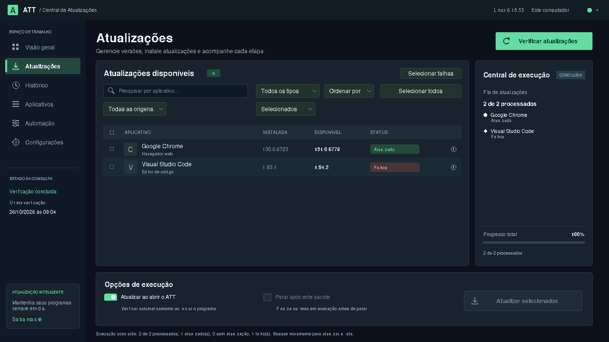
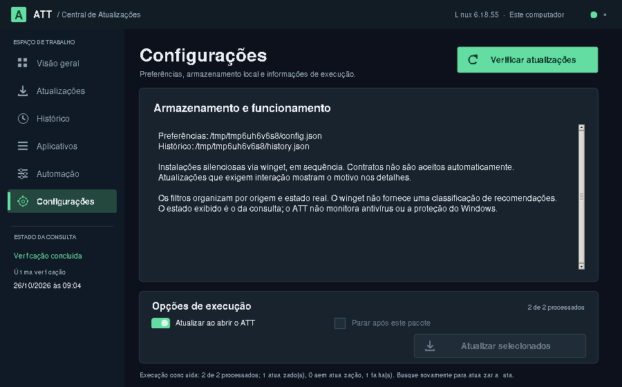

# Correção dos textos cortados e dos resultados que desapareciam

## Problemas reproduzidos

- Em janelas de 900 e 1100 pixels de largura, a linha de filtros exigia mais espaço do que o painel oferecia e cortava o botão de seleção.
- O texto “Desenvolvimento” ocupava a área da seta do menu.
- A janela inicial sempre pedia 720 pixels de altura, deixando pouco espaço para a barra de título e a barra de tarefas em notebooks.
- As informações de configurações e os detalhes longos precisavam de rolagem visível e quebra de linha.
- O filtro “Selecionados” ocultava os itens quando sua tentativa terminava, porque a marcação era removida. Isso também ocultava falhas.
- Uma nova consulta mantinha esse filtro apesar de limpar a seleção, deixando a lista vazia.

## Comportamento atual

Os controles se adaptam à largura disponível. Em telas menores, filtros mudam de
linha, os indicadores usam o modo compacto e as ações continuam acessíveis.
O tamanho inicial considera a tela disponível. Textos longos de Automação,
Configurações, Histórico e detalhes podem ser rolados.

O filtro “Selecionados” mantém os resultados da execução enquanto o usuário não
modificar a seleção. Uma nova consulta volta a “Todos os status” quando esse
filtro estava ativo. Sucesso e falha permanecem independentes para cada pacote.

**Selecionar falhas** marca somente os pacotes que falharam. A nova instalação
começa quando o usuário pressiona **Atualizar selecionados**; programas já
atualizados não são incluídos nessa seleção de falhas.

No ícone de informações, **Copiar detalhes** copia o pacote, a origem, o código
de erro e o retorno original do winget. Os detalhes também ficam no Histórico.

## Downloads e instaladores

O ATT reconhece mensagens específicas para falha de download, dependência que
não pôde ser baixada, ausência de rede, servidor indisponível por conexão,
outro instalador em andamento, termos pendentes, autenticação interativa e
recusa por integridade ou certificado. As definições de HRESULT foram conferidas
no [AppInstallerErrors.h oficial](https://github.com/microsoft/winget-cli/blob/master/src/AppInstallerSharedLib/Public/AppInstallerErrors.h).

O código e o texto original são preservados. Não há repetição automática de
instalações nem aceitação automática de termos. Uma falha de servidor, rede ou
instalador continua exigindo a ação indicada pela mensagem real.

O desaparecimento da lista foi reproduzido e corrigido. A causa específica dos
downloads relatados no Windows depende do pacote e de seu código de erro; os
testes deste ambiente usam respostas simuladas, não downloads de instaladores reais.

## Evidência visual

As capturas usam dados de exemplo:





## Verificação

A suíte exercita janelas de 900, 1100, 1200 e 1280 pixels de largura, abertura em
uma tela simulada de notebook, navegação em janela de 520 pixels de altura,
leitura da última linha das configurações, resultados mistos, cópia de erro,
seleção de falhas e nova tentativa somente do pacote que falhou.

```powershell
python -m unittest -v
```
