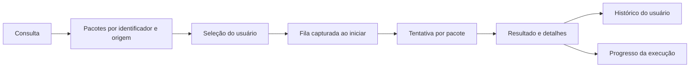

# Modelagem e cenários de estresse do ATT

## Referência utilizada

Práticas de [mattpocock/skills](https://github.com/mattpocock/skills), consultadas no
commit `5beb35b040e3de97e54fa9e386d7e42d15c295c2`:

- [domain-modeling](https://github.com/mattpocock/skills/blob/5beb35b040e3de97e54fa9e386d7e42d15c295c2/skills/engineering/domain-modeling/SKILL.md): definir os termos e confrontá-los com cenários concretos.
- [codebase-design](https://github.com/mattpocock/skills/blob/5beb35b040e3de97e54fa9e386d7e42d15c295c2/skills/engineering/codebase-design/SKILL.md): concentrar regras nos módulos que já oferecem as interfaces usadas pelo sistema.
- [tdd](https://github.com/mattpocock/skills/blob/5beb35b040e3de97e54fa9e386d7e42d15c295c2/skills/engineering/tdd/SKILL.md): reproduzir uma falha, corrigir esse caso e repetir com o cenário seguinte.

Os termos de negócio estão no [glossário](../GLOSSARY.md). A interface visual
permanece a mesma; esta revisão trata dos contratos e do comportamento.

## Fluxo e responsabilidades



- `WingetClient` interpreta a resposta do processo externo e identifica o resultado de uma tentativa. O código de saída tem significado diferente em consulta e atualização de um pacote.
- `ATTApp` captura a fila, impede execuções simultâneas na janela e aplica os resultados recebidos. Filtros não modificam a seleção ou uma fila em andamento.
- `Dashboard` organiza as telas, os filtros e a apresentação dos dados. `UpdateTable` concentra navegação e identificação da linha visível sob um clique.
- `ActivityStore` mantém os resultados retidos e a última verificação do usuário, incluindo os avisos quando não consegue gravar.

As correções ficaram nesses módulos existentes, sem exigir que seus chamadores
aprendam regras de formatação do winget ou cálculos de posição das linhas.

## Interfaces sob teste

| Interface | Dependência usada nos testes | O que verifica | Limite da evidência |
| --- | --- | --- | --- |
| `WingetClient.discover/list_installed/upgrade` | Respostas de processo no lugar do winget externo | Argumentos, códigos de saída, identidade e colunas | Não executa instaladores reais |
| `ActivityStore.record` e reabertura do histórico | Diretório temporário real | Persistência e retenção dos resultados | Não valida particularidades do disco Windows |
| Interação pública de `UpdateTable` | Tkinter com Xvfb e eventos de teclado | Foco inicial e identificação de linhas visíveis | Fontes e elementos nativos podem variar |
| Fluxos de `ATTApp` | Cliente de pacotes simulado e interface real | Seleção, fila, interrupção, histórico e falhas | Elevação de privilégio continua exigindo Windows |

Os testes do cliente winget substituem a execução do processo externo. Eles não
substituem métodos de interpretação do próprio cliente, de modo que uma mudança
na implementação continua passando pelo mesmo contrato observável.

## Bugs reproduzidos e corrigidos

| Cenário | Comportamento anterior | Regra após a correção |
| --- | --- | --- |
| Pacote removido depois da consulta; winget retorna `0x8A150014` | Era informado como “Sem atualização” | Uma tentativa sem pacote encontrado é “Falhou”; o código e a mensagem são preservados |
| Inventário com Nome, Id, Versão e Available/Disponível, sem origem | A versão disponível era interpretada como origem | A versão permanece em `available` e a origem fica ausente |
| Primeira seta para baixo em uma tabela sem foco de linha | Pulava para o segundo programa | Foca o primeiro programa |
| Clique no espaço residual abaixo das linhas inteiras desenhadas | Identificava a próxima linha, que não estava visível | Retorna ausência de linha; nenhum pacote oculto recebe o clique |

Cada um desses casos teve um teste falhando antes da correção e passando depois.
Os casos de inventário são exercitados com títulos em português e inglês; o
resultado de pacote ausente também é testado com o código representado como
inteiro negativo.

## Cenários adicionais de estresse do modelo

- **Mesmo identificador em duas origens:** ambos os pacotes permanecem distintos e a atualização usa a origem escolhida. Nome ou identificador isolado não substituem essa identidade.
- **Histórico no limite:** ao registrar uma nova tentativa após 1.000 resultados, a reabertura mantém os 1.000 mais recentes, incluindo a falha recém-registrada.
- **Pacote atualizado, sem atualização aplicável e falha:** os resultados continuam distintos; uma tentativa processada não implica que houve instalação.
- **Filtros, seleção e fila:** permanecem cobertos pela suíte existente, assim como a parada após o pacote atual, falha de inventário e erro de gravação do histórico.

## Executar a validação

```powershell
python -m unittest -v
```

Para exercitar somente os cenários desta revisão:

```powershell
python -m unittest -v test_modeling
```

A validação de interface requer uma tela ou Xvfb. Ausência de tela produz testes
ignorados explicitamente. Os cenários são de comportamento e modelagem; não
constituem um benchmark de carga nem substituem a validação de instalações no Windows.
